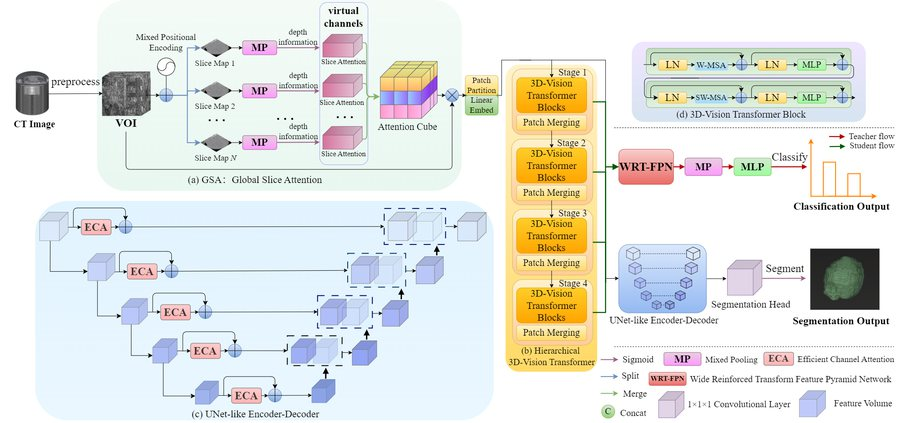
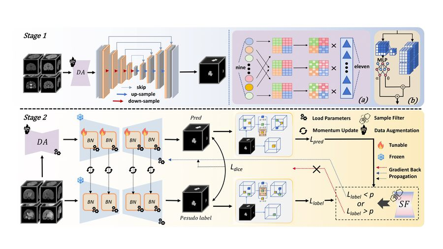
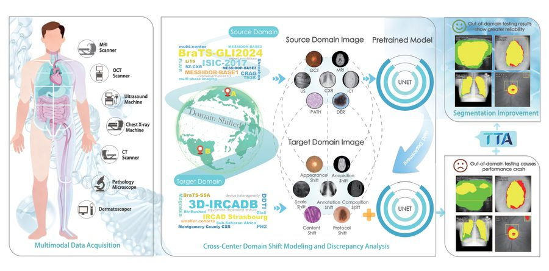
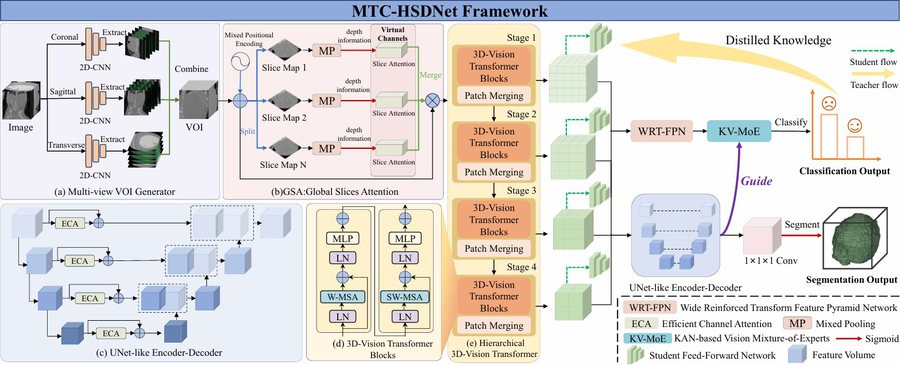
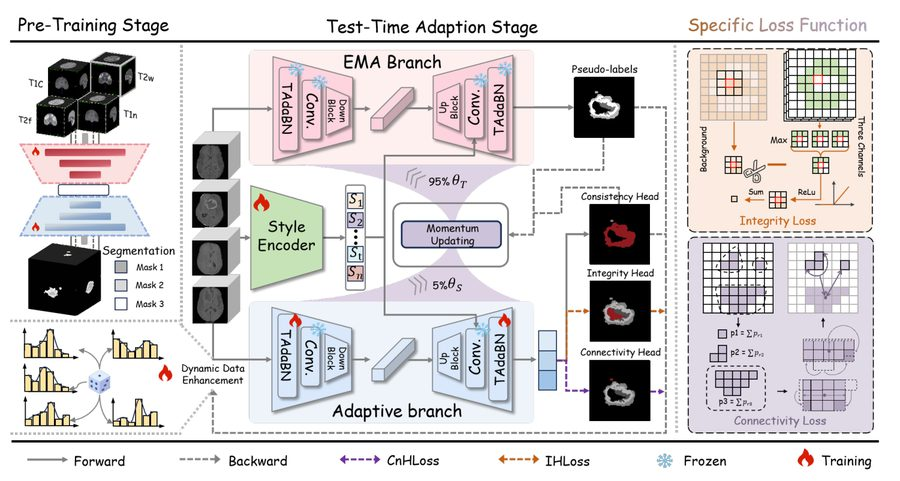

# 余文敬 · Wenjing Yu

**杭州电子科技大学 博士研究生** · 导师 [秦飞巍](https://faculty.hdu.edu.cn/jsjxy/qfw/main.htm) 教授

[3DV Lab](https://hdu-3dv.github.io/) (HDU) ∣ [BIRTH Lab](https://www.med.tsinghua.edu.cn/info/1143/2126.htm) (Tsinghua) ∣ SRIBD Lab (CUHK-Shenzhen) 联合培养

---

## 🧬 关于我

- 🔬 研究聚焦**医学影像智能分析**：让分割模型在低质量、跨中心、分布漂移的真实临床数据上依然可靠
- 🤝 与 [清华大学 BIRTH Lab](https://www.med.tsinghua.edu.cn/info/1143/2126.htm)（田启源 教授）、香港中文大学（深圳）SRIBD Lab（王昌淼 副教授）开展联合科研培养
- 📨 合作交流：`yuwenjing@hdu.edu.cn`

| 时间 | 经历 |
| :--- | :--- |
| **2025.9 – 至今** | 杭州电子科技大学 · 博士研究生 |
| 2021.9 – 2025.6 | 杭州电子科技大学 · 本科 · 计算机科学与技术 |

## 🔬 研究方向

## 📚 论文

### ✅ 已发表

| | 论文 |
| :---: | :--- |
|  | **MT-WilmsNet: A Multi-level Transformer Fusion Network for Wilms' Tumor Segmentation and Metastasis Prediction** Zhu Zhu, **Wenjing Yu**, Xiaohui Ma, Shuai Liu, Jie Dong, Yuxin Du, Changmiao Wang, Gang Yu   |
|  | **DR-TTA: Dynamic and Robust Test-Time Adaptation Under Low-Quality MRI Conditions**  |

### 🔄 在审 / 预印本

| | 论文 |
| :---: | :--- |
|  | **A Large Scale Benchmark for Test Time Adaptation Methods in Medical Image Segmentation** **Wenjing Yu**, Shuo Jiang, Yifei Chen, *et al.*  |
|  | **MTC-WTNet: A Multitask Collaboration Framework for Wilms' Tumor Segmentation and Preoperative Metastasis Prediction** 在审 |
|  | **SmaRT: Style-Modulated Robust Test-Time Adaptation for Cross-Domain Brain Tumor Segmentation**  |

**🧾 发明专利**：已申请 6 项，其中**第一发明人** 1 项（基于 DR-TTA 的神经胶质瘤分割测试时适应方法）

## 🏆 荣誉 & 主持项目

- 🎓 **MICCAI 2025 Early Accept**（学生一作）
- 🧪 **主持** 2027 年度浙江省自然科学基金「新苗项目」—— *有限标注下医学影像三维分割的可靠监督构建研究*（资助 10 万元）
- 💡 **主持** 杭州电子科技大学研究生科研创新基金 —— *基于测试时域适应的高精度自适应 MRI 脑肿瘤分割框架*
- 🏅 研究生学业奖学金（二等）· 国家励志奖学金 · 校级优秀学业奖学金 · 优秀班级干部

## 💻 开源项目

| 仓库 | 说明 | Stars |
| :--- | :--- | :---: |
| [MedSeg-TTA](https://github.com/wenjing-gg/MedSeg-TTA) | 医学图像分割测试时适应（TTA）研究与工具集 |  |
| [APRNet](https://github.com/wenjing-gg/APRNet) | 论文官方代码 · 解剖先验引导的半监督上颌窦分割 |  |
| [OhMyPaper](https://github.com/wenjing-gg/OhMyPaper) | 论文查询 · 管理 · AI 问答 App |  |
| [DisPAM](https://github.com/wenjing-gg/DisPAM) | 无源域自适应医学影像分割 |  |
| [AortaSeg](https://github.com/wenjing-gg/AortaSeg) | 伪孪生自适应主动脉夹层分割（已申请专利） |  |
| [MT-WilmsNet](https://github.com/wenjing-gg/MT-WilmsNet) | MICCAI 2025 论文官方代码 |  |

## 📊 GitHub 统计

 

 

---

*「潜龙勿用，见龙在田，终日乾乾，或跃在渊，飞龙在天，亢龙有悔。」* —— 《周易 · 乾》

